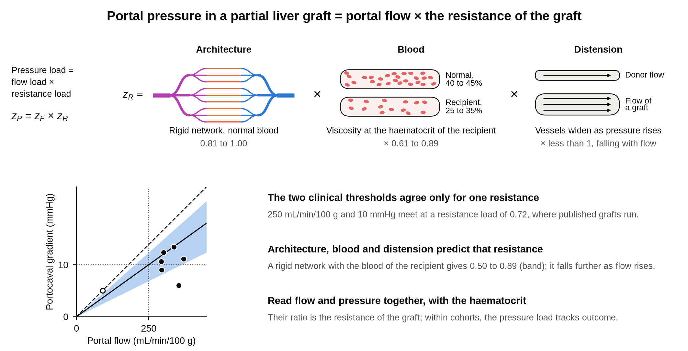

# LiPNet - Liver Perfusion Network model

### A physics-based model of hepatic perfusion and haemodynamic load in partial liver grafts


[](https://github.com/Danpc11/LiPNet/actions/workflows/tests.yml)
[](https://danpc11.github.io/LiPNet/)

[](https://doi.org/10.5281/zenodo.22861276)

---

## What this is

LiPNet treats the liver as a vascular transport network and asks a single question: what turns portal flow into portal pressure?

The answer is one identity. It follows from the definition of vascular resistance, $R=\Delta P/Q$ per 100 g, and splits the pressure load into a flow component and a resistance component:

$$\boxed{z_P = z_F \, z_R}\qquad\text{pressure load}=\text{flow load}\times\text{resistance load}$$

$$z_F=\frac{\text{graft PVF per }100\,\text{g}}{\text{donor PVF per }100\,\text{g}},\qquad
z_P=\frac{\text{PVP}-\text{CVP}}{5\ \text{mmHg}},\qquad
z_R=\frac{R_{\text{graft}}}{R_{\text{donor}}}$$

Because $z_P/z_F=(\Delta P_{\text{graft}}/\Delta P_{\text{donor}})/(Q_{\text{graft}}/Q_{\text{donor}})=R_{\text{graft}}/R_{\text{donor}}$, the identity holds exactly, by definition: it is not evidence of a mechanism. What can be wrong is the value of $z_R$ the network predicts, and what the cohorts report is a third thing.

All three loads equal 1 in a healthy donor. Flow and pressure therefore carry the same information only while $z_R=1$. The network keeps a partial graft between 0.8 and 1. That prediction uses the geometry of the network and the two inflows, and no pressure of a recipient. In the six published groups that report both loads (five cohorts), at three to four times the donor's flow, $z_R = 0.31,\;0.54,\;0.55,\;0.65,\;0.72,\;0.74$: all below one (exact sign test over cohorts, one-sided $p=0.031$), and at the reference values all below the prediction, which is 0.85 on average against an observed 0.58. The model has the direction of the separation and under-predicts its size. The surgical configuration does not order the groups: the one with no manoeuvre is at 0.72, inside the range of the three with outflow reconstruction alone (0.31 to 0.74).

The network is rigid. Three published relations for the passive behaviour of the normal liver, with nothing fitted, give 0.39 to 0.82 at these flow loads: five of the six groups are compatible with that span (each within it with probability 0.35 to 0.68 once every uncertainty is drawn together), and Chan 2011 lies below it. Applied vessel by vessel, the relations reach the lower values only if the portal tree distends. They come from normal cat livers and are read as the largest plausible passive contribution, not a prediction for a reperfused graft ([docs/LIVER.md](docs/LIVER.md), section 7).

The outcome analysis is an association between groups of one cohort, not the effect of pressure on a patient. The comparison of clinical thresholds is exploratory: the thresholds are each about 10 mmHg, so their agreement at $z_P=2$ follows from the 5 mmHg reference and is not a prediction. [THEORY.md](THEORY.md) keeps the three levels apart: identity, prediction of the network, association in the series.

The derivation, the four predictions that follow from it and all the numbers are in **[THEORY.md](THEORY.md)**.

<p align="center">
  
</p>

---

## Included clinical series

Thirty-two groups from eighteen published series of adult living-donor liver transplantation. Every value in `data/series.tsv` carries its source table and page, and a provenance label.

| Series | Journal | Link |
|---|---|---|
| Troisi 2003 | Liver Transpl 2003;9(9):S36–41 | [10.1053/jlts.2003.50200](https://doi.org/10.1053/jlts.2003.50200) |
| Troisi 2005 | Am J Transplant 2005;5(6):1397–1404 | [10.1111/j.1600-6143.2005.00850.x](https://doi.org/10.1111/j.1600-6143.2005.00850.x) |
| Yagi 2005 | Liver Transpl 2005;11(1):68–75 | [10.1002/lt.20317](https://doi.org/10.1002/lt.20317) |
| Yagi 2006 | Transplantation 2006;81(3):373–378 | [10.1097/01.tp.0000198122.15235.a7](https://doi.org/10.1097/01.tp.0000198122.15235.a7) |
| Yamada 2008 | Am J Transplant 2008;8(4):847–853 | [10.1111/j.1600-6143.2007.02144.x](https://doi.org/10.1111/j.1600-6143.2007.02144.x) |
| Botha 2010 | Liver Transpl 2010;16(5):649–657 | [10.1002/lt.22043](https://doi.org/10.1002/lt.22043) |
| Ogura 2010 | Liver Transpl 2010;16(6):718–728 | [10.1002/lt.22059](https://doi.org/10.1002/lt.22059) |
| Ou 2010 | Transplant Proc 2010;42(3):876–878 | [10.1016/j.transproceed.2010.02.064](https://doi.org/10.1016/j.transproceed.2010.02.064) |
| Chan 2011 | Liver Transpl 2011;17(2):115–121 | [10.1002/lt.22034](https://doi.org/10.1002/lt.22034) |
| Wu 2011 | Liver Transpl 2011;17(9):1035–1045 | [10.1002/lt.22326](https://doi.org/10.1002/lt.22326) |
| Ishizaki 2012 | Liver Transpl 2012;18(3):305–314 | [10.1002/lt.22440](https://doi.org/10.1002/lt.22440) |
| Vasavada 2014 | Int J Surg 2014;12(2):177–180 | [10.1016/j.ijsu.2013.12.006](https://doi.org/10.1016/j.ijsu.2013.12.006) |
| Wang 2014 | Surg Today 2015;45(8):979–985 | [10.1007/s00595-014-0999-9](https://doi.org/10.1007/s00595-014-0999-9) |
| Alim 2016 | Liver Transpl 2016;22(12):1643–1648 | [10.1002/lt.24523](https://doi.org/10.1002/lt.24523) |
| Uemura 2016 | Surgery 2016;159(6):1623–1630 | [10.1016/j.surg.2016.01.009](https://doi.org/10.1016/j.surg.2016.01.009) |
| Kanetkar 2017 | J Clin Exp Hepatol 2017;7(3):235–246 | [10.1016/j.jceh.2017.01.114](https://doi.org/10.1016/j.jceh.2017.01.114) |
| Osman 2017 | Hepatol Res 2017;47(4):293–302 | [10.1111/hepr.12727](https://doi.org/10.1111/hepr.12727) |
| Yao 2018 | Transplantation 2018;102(4):623–631 | [10.1097/TP.0000000000002047](https://doi.org/10.1097/TP.0000000000002047) |

Every value in the extraction is sourced to its table and page in `data/series.tsv`.

---

## Calculator

A browser-based research calculator is available at:

**https://danpc11.github.io/LiPNet/**

The calculator runs locally in the browser.

Users can enter:

- current PVP,
- current CVP,
- expected pressure after a planned manoeuvre,
- a reference event rate or cohort-specific baseline.

The calculator returns:

- $z_F$,
- $z_P$,
- $z_R$,
- the estimated odds ratio associated with a pressure change,
- an absolute risk estimate anchored to the user-provided baseline.

The slope, its interval, the per-series levels and the prediction bands all come from the same posterior, the **primary analysis** of the paper: the hierarchical model fitted to small-for-size syndrome or early graft dysfunction, $\mu_\beta$ = +1.55 (95% CrI +0.33 to +2.79), an odds ratio of 4.70 per unit of $z_P$ and 1.36 per mmHg of gradient, from 7 groups in 3 series (76 events in 573 recipients). The reference series it offers are the same three, so the outcome you anchor on matches the outcome the slope was fitted on. Anchoring on a cohort's overall rate and average gradient is an approximation, because the average risk of a spread-out cohort is not the risk at its average gradient; anchoring on a rate measured at one gradient has no such error, and the page says so.

If a user provides a reference probability:

$$p_{\mathrm{ref}}$$

at pressure load:

$$z_{\mathrm{ref}},$$

the model uses:

$$\mathrm{logit}\,p(z)=\mathrm{logit}\,p_{\mathrm{ref}}+\mu_\beta(z-z_{\mathrm{ref}}).$$

The resulting curve therefore passes through the supplied clinical anchor.

---

### Recalibration

A centre can estimate its own baseline using:

```python
indices.baseline_from_rate(rate, mean_zP, beta)
```

which computes:

```text
alpha = logit(rate) - beta * mean(zP)
```

For local outcome data, the intercept can be recalibrated using:

```python
indices.recalibrate(outcomes, zP, beta)
```

while keeping the slope fixed.

This corresponds to recalibration-in-the-large, a standard first step in prediction-model updating.

---

## Repository structure

```text
src/model/
    Network model:
    - 2D and 3D vascular graphs
    - optimization
    - closed-form scaling
    - allometric closure

src/predictions.py
    Tests predictions P1-P4, with the sweep of the two
    normalisation references behind zR (P2)
    Output:
    results/predictions.json

src/indices.py
    Calculates:
    - zF
    - zP
    - zR
    - stratified models
    - hierarchical models
    - internal-external validation
    - recalibration

src/fem/
    Lobule-scale finite elements:
    - anisotropic Darcy perfusion
    - O2 with haemoglobin, ethanol, acetaldehyde, drug
    - sinusoid/hepatocyte two-phase exchange, zonal membrane
    - NO wall sub-model
    - shape factor and z_R(z_F) back to the network
    Output:
    results/fem_*.json, results/fem_*.pdf

src/ipd/
    Patient-level layer:
    - Kaplan-Meier reconstruction (Guyot)
    - within-group dispersion model
    Output:
    results/ipd_*.json

src/plots.py
    Generates 19 stand-alone figures

src/cache.py, src/manifest.py
    Fingerprint of the inputs behind each cached fit; manifest of inputs,
    results and versions of a run; check of figures and cached tables

src/model/verify_campaigns.py
    Reruns the model campaigns and compares them with the cached tables
    Output:
    results/campaign_check.json

src/paper_figures.py
    The eleven figures of the article (Figures 1 to 4, S1 to S7)
    Output:
    results/Figure_*.pdf and .png

src/figstyle.py
    The one style those figures share (docs/FIGURES.md)

src/build_app.py
    Rebuilds the browser calculator

data/series.tsv
    32 groups from 18 published clinical series

sfss_calculator.html
index.html
tests/
src/model/liver.py
    The optimum applied to a human liver:
    - wall shear of each vessel against the scale tau0
    - exponent b of each human vascular cast
    - share of the pressure drop by compartment
    - a partial graft as a sub-network, with two inflows
    Output:
    results/model_liver.json

src/model/human.py
    The optimum in physical units for a human liver:
    - calibration against the human vascular cast, exponent b of the portal vein
    - one lobular pressure drop shared with src/fem
    - growth with the body and regrowth of a graft
    Output:
    results/model_human.json

src/audit.py
    What the table and the fits support
    Output:
    results/audit.json

docs/FEM.md
docs/IPD.md
docs/LIVER.md
docs/HUMAN.md
docs/FIGURES.md
run_all.sh
```

---

## Reproduce the analysis

Install the dependencies:

```bash
pip install -r requirements.txt
```

`requirements-lock.txt` is the complete environment, every package and dependency at an exact version, in which this release was rebuilt from an empty `results/` and its tests passed. Use it to reproduce the cached posterior summaries to the last digit rather than to Monte Carlo error:

```bash
python -m venv .venv && . .venv/bin/activate && pip install -r requirements-lock.txt
```

Run the complete workflow:

```bash
./run_all.sh            # reuses a cached fit only if it was computed from this table and this model code
./run_all.sh --clean    # deletes every generated result and recomputes everything: the run to do before quoting a number
python src/manifest.py check    # numbers, figures and cached tables on disk are the ones their inputs give
```

The record of the clean rebuild of this release, what the continuous integration runs and how to audit a fixed commit are in [docs/REPRODUCTION.md](docs/REPRODUCTION.md).

Five things make a result on disk traceable to its inputs.

| What | How | Where |
|---|---|---|
| Cached fits | A fit carries the fingerprint of `data/series.tsv`, `src/bayes.py` and `src/indices.py`. If any of the three changes, `predictions.py` fits again instead of reading the cache; `LIPNET_REBUILD=1` ignores every cache. | `src/cache.py`, `results/bayes_inputs.json` |
| Cached tables of the model | The 2D and 3D campaigns and the exact certificate in `data/` are not rebuilt by `run_all.sh`. `python src/model/verify_campaigns.py` reruns the code behind them and compares every number; `run_all.sh --clean` does it. In this release the 35 rows are reproduced with a relative difference of zero. | `results/campaign_check.json` |
| Figures | When a figure is drawn, the hash of every file it reads, of the two scripts that draw it and of the two images is recorded. The check names a figure whose input, script or image has changed since. | `results/figures_provenance.json` |
| Everything | `run_all.sh` ends by writing the hash of every input and every numeric result, the versions of Python and the packages, and the commit. | `results/MANIFEST.json` |
| Stored predictions | `results/predictions.json` is kept in the repository; a test recomputes what is not sampled in it and compares, so a stored file that was not regenerated fails. | `tests/test_cache.py` |

`tests/test_article.py` checks the numbers quoted in the article against the results. Counts and arithmetic are compared exactly. Posterior means and interval limits are reproducible to the last digit only on the locked environment, and move in the second decimal on another version of the numerical libraries, so they are compared within a stated tolerance (0.05 for a posterior mean, 0.10 for a limit of a 95% interval); `LIPNET_EXACT=1 pytest tests/test_article.py` asks for the printed digits.

This reproduces:

- haemodynamic indices,
- predictions,
- statistical analyses,
- figures,
- calculator.

Typical runtime is about four minutes with the cached fits, and about 25 with `--clean`, which fits the hierarchical models again and recomputes the cached tables of the model.

To run only the four main predictions:

```bash
python src/predictions.py
```

To generate the summary prediction figure:

```bash
python src/plots.py predictions
```

The model campaigns used to generate the cached tables are stored in:

```text
src/model/
```

They include:

- optimized networks from 37 to 1478 lobules,
- 2D and 3D networks,
- exhaustive optimization on seven lobules,
- allometric closure.

The corresponding commands are documented in:

```text
run_all.sh
```

---

## Data

The main clinical dataset is:

```text
data/series.tsv
```

It contains raw published values.

The normalized indices are not stored as fixed results.

They are recalculated by:

```text
src/indices.py
```

Each variable includes provenance information.

The `*_basis` columns identify whether each value was:

- reported,
- derived,
- imputed,
- defined by a threshold,
- not applicable.

Structural variables include:

- `centre_id`,
- `cohort_id`,
- `recruitment_start`,
- `recruitment_end`,
- `overlap_set`,
- `outflow`,
- `gradient_timing`,
- `gradient_sd`,
- `outcome_definition`,
- `outcome_horizon`,
- `modulation_strategy`.

These fields are used to distinguish publications, cohorts, centres and overlapping patient populations.

Groups defined only by a clinical cut-off are excluded from the primary analysis.

Second partitions of already-counted cohorts are also excluded from the primary analysis.

They are reported separately in:

```text
results/sensitivity.tsv
```

The eighteen series and their links are listed in [Included clinical series](#included-clinical-series) above.

---

## Inside the lobule

The network model represents a whole lobule as one edge of conductance $w=r^4/l$: a rigid
Poiseuille tube whose resistance does not depend on its flow. `src/fem/` opens that edge
up with a finite-element model of a single hexagonal lobule, and hands two things back.

The first is a shape factor. Comparing the computed resistance against an equal-area radial
annulus with the same permeability gives $\kappa = R_{\text{FEM}}/R_{\text{annulus}} = 0.996$,
so the hexagonal outline costs the network model essentially nothing. The single edge is a
better idealisation than it looks.

The second is the part that is not geometric. Driving the lobule at a prescribed flow and
closing the loop shear $\to$ eNOS $\to$ sinusoidal calibre $\to$ permeability gives a
resistance that falls as flow rises:

| $z_F$ | 0.5 | 1 | 1.5 | 2 | 3 | 4 |
|---|---|---|---|---|---|---|
| lobule $z_R$ | 1.21 | 1.00 | 0.85 | 0.74 | 0.59 | 0.56 |

With the feedback gain at zero this is identically 1, so the two models are nested.

Put back into the series, though, the effect is small. The lobule holds 1 mmHg of the 5 mmHg
between the portal vein and the vena cava, the same drop in the lobule layer and in the
network (`docs/HUMAN.md`). That fifth is what the dissipation-optimal network gives its
sinusoids on the explicit graph of 151 lobules (21%); left to the optimum at the size of a
human liver it would be 4 to 12%. The published measurements span it (0 in the cat and dog,
0.08 to 0.26 by micropuncture in the rabbit, a third in the perfused rat, 0.44 by
micropuncture in the rat). At that share a
graft at four times the donor's flow per gram reaches a measured $z_R$ of 0.91, not the
0.31 to 0.74 of the published series. Sinusoidal autoregulation is a small, same-signed
background term to be subtracted before attributing the rest, not a competing explanation
for the clinical observation.

The same solve also puts 47% of the intralobular pressure drop in the quarter nearest the
central vein, reproducing the outlet-dominated profile that Henriksen and Lassen derived in
1988 from a quite different argument.

The same solve carries oxygen with its haemoglobin-bound pool, ethanol through ADH and
CYP2E1, acetaldehyde, and a pericentrally cleared drug, either in one continuum or with the
sinusoid and the hepatocyte separated by a membrane of finite permeability. Without fitting, it reproduces a
periportal-to-pericentral $pO_2$ of 56 to 33 mmHg, 33% hepatic oxygen extraction, a
transit time of 8.6 s and a sinusoidal wall shear stress of 0.19 Pa, and it puts the
reactive drug metabolite and the acetaldehyde peak where centrilobular necrosis is.

```bash
python src/fem/run_fem.py all
python tests/test_fem.py
```

The derivation, the numerical traps and the limits are in **[docs/FEM.md](docs/FEM.md)**.

---

## Limitations

The main clinical analysis uses aggregated group-level data.

Prediction 3 is based on five series from three centres (Cairo, Fukuoka, Kyoto), with 104 clinical events.

Only three series report the primary outcome.

Several Kyoto publications overlap in recruitment period.

These limitations reduce the amount of independent information available for estimating between-study heterogeneity.

CVP is not available in all studies.

When CVP is assumed as a constant within a study, it shifts all groups from that study by the same amount on the $z_P$ axis.

This does not change the within-study slope because the study-specific intercept absorbs the shift.

It can, however, change the absolute position of the groups on the normalized pressure scale.

Because the available data are aggregated, the analysis can estimate:

- likelihood,
- deviance,
- observed-to-expected ratios,
- study-level slopes.

It cannot provide reliable individual-level measures such as:

- c-statistic,
- individual calibration curves,
- Brier score,
- decision-curve analysis.

These limitations apply mainly to Prediction 3.

Predictions 1, 2 and 4 do not depend on the hierarchical outcome model.

The calculator is therefore a **research tool**.

It is not a medical device and should not be used as a stand-alone tool for clinical decision-making.

---

## Scope

LiPNet is a mechanistic framework, not an individual risk score. It gives a common normalised language for portal hyperperfusion, venous outflow reconstruction, small-for-size physiology, portal hypertension, hepatic resection and vascular obstruction, and it says which part of that language transfers between centres: the change in risk with a change in load does, the baseline risk does not.

---

## Publication

The article associated with this repository is currently in preparation:

**Vascular resistance modulates portal flow-pressure decoupling in partial liver grafts**

Until a preprint is available, please cite the archived software release.

---

## Citation

The software is archived on Zenodo. The article uses release v0.7.3, which receives its own DOI when the release is published; the last archived version is v0.4.2:

**DOI: 10.5281/zenodo.23656741** (v0.4.2) · [10.5281/zenodo.22861276](https://doi.org/10.5281/zenodo.22861276) (all versions)

A machine-readable citation is also available in:

```text
CITATION.cff
```

---

## Licence

Source code is distributed under:

**PolyForm Noncommercial 1.0.0**

https://polyformproject.org/licenses/noncommercial/1.0.0

Clinical values stored in `data/` remain the intellectual property of the authors of the original publications.
